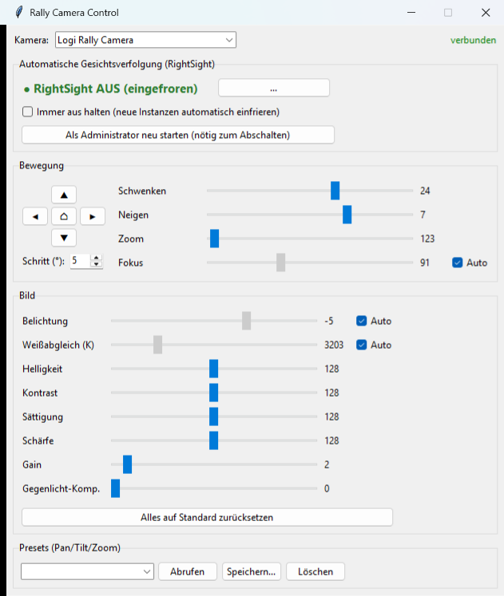

# Rally Camera Control

Kleine Windows-GUI zur Steuerung der **Logitech Rally Camera** – inklusive Schalter, um die
automatische Gesichtsverfolgung (**RightSight**) abzustellen.



## Funktionen

- **Bewegung:** Pan (−90…90°), Tilt (−90…50°), Zoom (1×…15×) per Regler oder Pfeiltasten (Dauerklick), Home-Taste
- **Bild:** Fokus, Belichtung und Weißabgleich (jeweils mit Auto-Haken), Helligkeit, Kontrast, Sättigung,
  Schärfe, Gain, Gegenlicht-Kompensation, „Alles auf Standard“
- **RightSight an/aus:** schaltet die automatische Gesichtsverfolgung ab und wieder an
- **Presets:** Pan/Tilt/Zoom-Positionen speichern, abrufen, löschen (`presets.json`)
- **Live-Werte:** Regler zeigen laufend den echten Zustand der Kamera
- Funktioniert mit jeder UVC-Kamera, die PTZ-Steuerung anbietet (Kamera oben auswählbar)

## Wie das Abschalten von RightSight funktioniert

Bei der Rally Camera läuft RightSight nicht in der Kamera, sondern als Prozess
`RightSightService.exe` von **Logi Sync** auf dem PC. Er wertet das Bild aus und schwenkt die Kamera.

- **AUS** friert diesen Prozess ein (Suspend), **AN** setzt ihn fort.
- Nichts wird beendet, deinstalliert oder in Logi Sync umkonfiguriert; Logi Sync läuft normal weiter.
- Dafür sind **Administrator-Rechte** nötig. Die Exe fragt beim Start automatisch per UAC danach.
- „Immer aus halten“ friert neu gestartete Instanzen (z. B. nach Neustart von Logi Sync) automatisch wieder ein.
- Solange RightSight aktiv ist, überschreibt es deine Pan/Tilt/Zoom-Eingaben.

## Installation

### Exe

`RallyControl.exe` starten und die UAC-Abfrage bestätigen.
Beim ersten Start kann SmartScreen warnen (unsignierte Exe): *Weitere Informationen → Trotzdem ausführen*.

### Aus dem Quellcode

Voraussetzungen: Windows, Python 3.12.

```bash
pip install -r requirements.txt
python rally_gui.py
```

Ohne Administrator-Rechte funktioniert alles außer dem Ein-/Ausschalten von RightSight
(die GUI bietet dafür „Als Administrator neu starten“ an).

### Exe selbst bauen

```bash
pip install pyinstaller
pyinstaller --noconfirm --onefile --windowed --uac-admin --name RallyControl --collect-all pygrabber --collect-submodules comtypes rally_gui.py
```

Die Exe liegt danach in `dist/`.

> **Hinweis:** Auf einem **Netzlaufwerk** (z. B. gemapptes `Z:`) lässt sich die App nicht mit
> Administrator-Rechten starten, weil Admin-Prozesse gemappte Laufwerke nicht sehen.
> Bitte lokal ablegen.

## Technik

- `uvc.py` – Zugriff auf `IAMCameraControl` / `IAMVideoProcAmp` (DirectShow) über `comtypes`/`pygrabber`
- `rally_gui.py` – Tkinter-Oberfläche, RightSight-Steuerung über `psutil` (Suspend/Resume)

## Haftungsausschluss

Inoffizielles Projekt, nicht mit Logitech verbunden. „Logitech“, „Rally“, „RightSight“ und „Logi Sync“
sind Marken ihrer jeweiligen Inhaber. Nutzung auf eigene Verantwortung.
